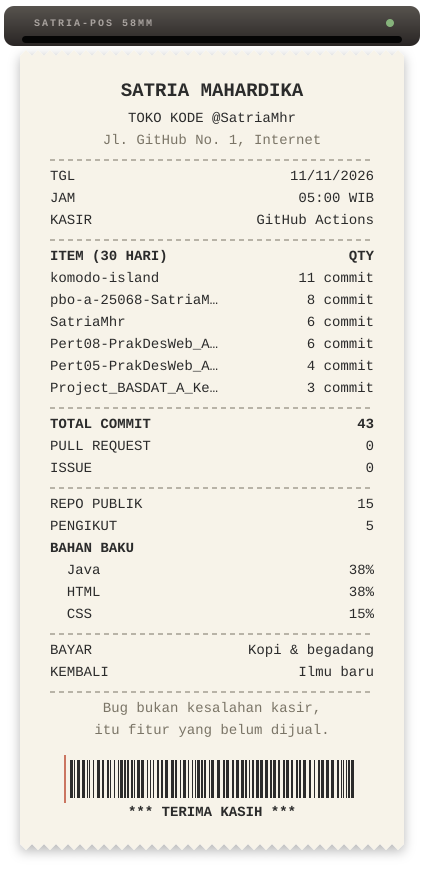

 

Halo, aku Satria. Aku suka bikin hal-hal kecil di web dan merapikan pekerjaan yang berulang jadi otomatis, mulai dari tugas kuliah sampai hal-hal kecil yang bikin hidup lebih gampang.

Belakangan aku lagi memperdalam **JavaScript / Node.js** dan **C++**, sambil belajar. Kalau mau diskusi soal web, pemrograman, atau sekadar tukar catatan belajar, kabari aja.

Struk ini dicetak otomatis tiap hari oleh script Node.js buatanku sendiri, lewat GitHub Actions. 
Isinya aktivitas 30 hari terakhir, jadi selalu berubah.

  

